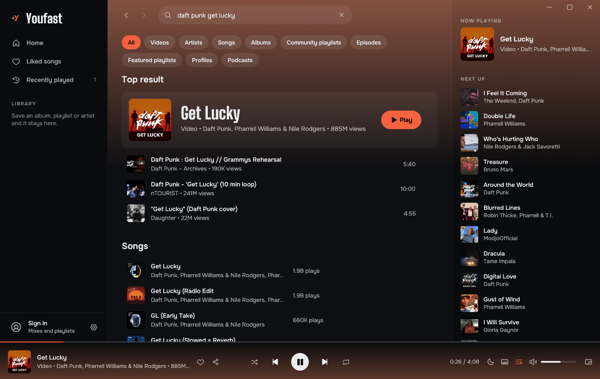
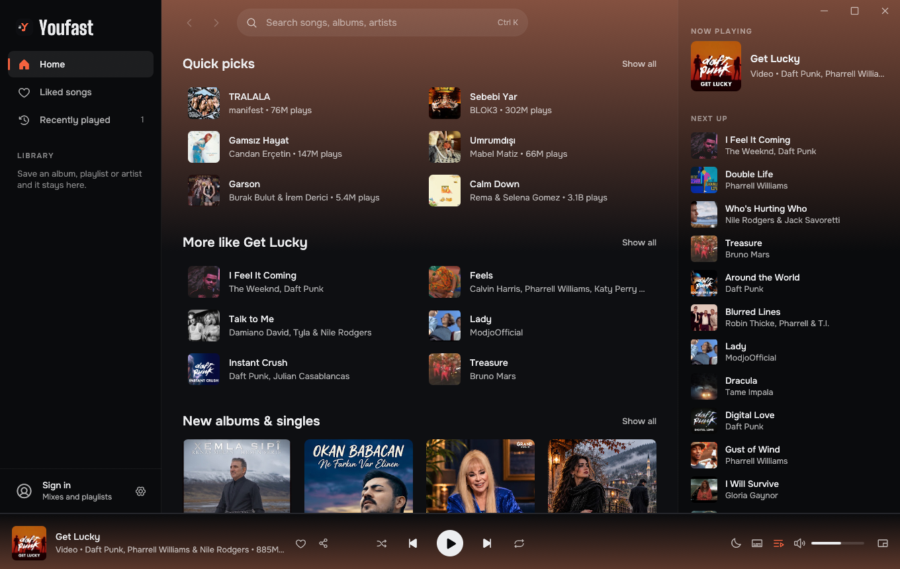

<p align="center">
  
</p>

<h1 align="center">Youfast</h1>

<p align="center"><strong>YouTube Music, native and fast.</strong><br>A lightweight desktop player for Windows, macOS and Linux with no browser engine inside.</p>

<p align="center">
  <a href="https://github.com/blntunlan/youfast-releases/releases/latest"></a>
  <a href="https://github.com/blntunlan/youfast-releases/releases"></a>
  
  <a href="LICENSE"></a>
</p>

<p align="center">
  <a href="https://github.com/blntunlan/youfast-releases/releases/latest/download/youfast.exe"><strong>Windows</strong></a> ·
  <a href="https://github.com/blntunlan/youfast-releases/releases/latest/download/youfast-macos-universal.zip"><strong>macOS</strong></a> ·
  <a href="https://github.com/blntunlan/youfast-releases/releases/latest/download/Youfast-x86_64.AppImage"><strong>Linux</strong></a> ·
  <a href="https://github.com/blntunlan/youfast-releases/releases">All versions</a>
</p>

<p align="center">
  
</p>

## Why Youfast

Youfast talks to YouTube Music directly, decodes the audio itself and draws every pixel natively. There is no Chromium and no WebView underneath, so it opens instantly and stays small.

| | |
|---|---|
| Window on screen | 0.1 to 0.3 seconds |
| Memory while playing | about 100 MB |
| CPU while playing | under 1 % |
| Download | one file, about 10 MB |

## Features

- **Search and browse** with results as you type, and artist, album and playlist pages.
- **A queue that keeps going.** When it runs out, a radio based on the last song continues it. Shuffle, repeat, drag to reorder, and undo if you replace it by accident.
- **Now playing and synced lyrics**, line by line, with plain lyrics as a fallback.
- **Mini player** with `Ctrl` + `M`: a compact, always-on-top card.
- **Media keys and global hotkeys** that work while a game or any other app has focus.
- **Media overlay** over windowed and borderless games, without taking focus.
- **Minimize to tray** so music keeps playing with the window closed.
- **Discord status** showing what you are listening to, off until you turn it on.
- **Your library kept locally**: liked songs, history, saved albums, playlists and artists.
- **One-click updates.** When a new version is out, Youfast offers it in a card. One click downloads it, checks it against `SHA256SUMS.txt` and restarts.

<p align="center">
  
</p>

## Install

### Windows

1. Download [`youfast.exe`](https://github.com/blntunlan/youfast-releases/releases/latest/download/youfast.exe), or [`youfast-windows-x64.zip`](https://github.com/blntunlan/youfast-releases/releases/latest/download/youfast-windows-x64.zip) if you prefer a zip.
2. Put it in a folder of your own, such as `Documents\Youfast`, and run it.

Youfast is not code signed, so the first launch may show "Windows protected your PC". Choose **More info**, then **Run anyway**.

### macOS

Apple silicon and Intel, macOS 11 or later.

1. Download [`youfast-macos-universal.zip`](https://github.com/blntunlan/youfast-releases/releases/latest/download/youfast-macos-universal.zip), unzip it and move `Youfast.app` to **Applications**.
2. Youfast is not notarized, so clear the download flag once:

```sh
xattr -dr com.apple.quarantine /Applications/Youfast.app
```

### Linux

x86-64, any distribution with glibc 2.35 or newer.

```sh
chmod +x Youfast-x86_64.AppImage
./Youfast-x86_64.AppImage
```

Prefer a menu entry? Download `youfast-linux-x64.tar.gz`, unpack it and run `youfast/install.sh`.

## Updates

Youfast checks this repository for a newer version when it starts. If there is one, a card at the bottom left offers **Update and restart**. The new file is checked against the release's `SHA256SUMS.txt` before it replaces the old one, and your library, settings and sign-in stay as they are. Nothing is installed without your click.

## Check a download

Every release lists the SHA-256 of each file in `SHA256SUMS.txt`.

```sh
sha256sum -c SHA256SUMS.txt --ignore-missing
```

On Windows: `Get-FileHash youfast.exe` and compare it with the line in `SHA256SUMS.txt`.

## Shortcuts

| Key | Action |
|---|---|
| `Space` | Play or pause |
| `Ctrl` + `K` or `/` | Jump to search |
| `Ctrl` + `→` / `Ctrl` + `←` | Next / previous song |
| `Ctrl` + `Z` | Bring back the queue you just replaced |
| `Ctrl` + `M` | Mini player |
| `Ctrl` + `Alt` + `O` | Media overlay (turn on global hotkeys in Settings) |

## Privacy

Youfast talks to YouTube, to GitHub for updates and to lrclib.net for lyrics YouTube does not have. Your sign-in stays on your computer, encrypted with your Windows account or readable only by your user on macOS and Linux. There is no telemetry.

## Good to know

Youfast is unofficial. It is not affiliated with, endorsed by or sponsored by YouTube or Google. YouTube and YouTube Music are trademarks of Google LLC. YouTube's Terms of Service do not provide for third-party clients, so use it at your own risk.

Youfast is based on [Tubefast](https://github.com/yigitbozyaka/tubefast) by Yiğit Bozyaka, and is released under the [MIT license](LICENSE).

## Questions and bugs

Open an [issue](https://github.com/blntunlan/youfast-releases/issues). If Youfast crashed, attach `crash.log` from `%APPDATA%\youfast\data` on Windows, `~/Library/Application Support/youfast` on macOS or `~/.local/share/youfast` on Linux.
